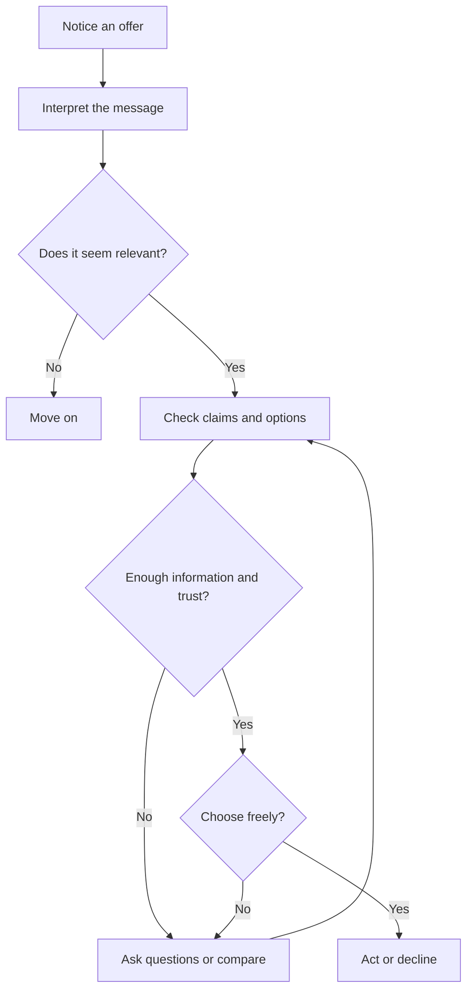

# Persuasion and Human Decision-Making

Persuasion is part of ordinary life. We use it when we explain why a plan is worthwhile, recommend a book, make a case for a change, or design a sign that helps someone choose a route. In branding and design, persuasion helps shape what people notice, how they interpret an offer, whether they trust it, and what action they take.

## What Is Persuasion?

**Persuasion is communication intended to influence what someone thinks, feels, or does while leaving them able to make their own choice.** It can offer reasons, tell a story, create an emotional response, or make useful information easier to see. Persuasion does not guarantee that the audience will agree. It gives them something to consider.

Imagine a plain white T-shirt. One seller describes its fabric, fit, and price. Another shows it folded beside a packed bag and calls it a dependable travel layer. Both presentations direct attention and shape interpretation. The second gives the shirt a story, but the story is ethical only if it does not imply performance the shirt cannot provide.

Persuasion is not automatically good or bad. The important questions are whether the message is truthful, whether the audience can assess it, and whether their choice remains meaningfully their own.

## Persuasion, Manipulation, and Coercion

Persuasion makes a case. It gives people reasons or a frame for understanding an option, and it leaves room to disagree.

**Manipulation** tries to steer a decision by hiding important information, exploiting a vulnerability, or creating a misleading impression. For example, a shirt campaign could imply that the garment is sustainably made without evidence, or use a fake countdown to make shoppers believe they have only minutes to decide.

**Coercion** uses a threat or force to make someone comply. It is different from an advertisement that invites someone to buy a shirt: a coercive demand removes a person's practical freedom to refuse.

The boundaries can depend on context and power. A technically optional choice may still feel pressured if a person risks losing access, safety, or an important relationship by saying no. Designers should pay attention not only to what a message says, but also to who controls the choice and what refusal costs.

## Cialdini's Principles of Influence

Psychologist Robert Cialdini describes principles that help explain why certain messages and situations can influence people. They are patterns to understand, not guaranteed buttons for controlling an audience. The same principle can support an informed decision or be used to distort one.

- **Reciprocity:** People often feel inclined to return a benefit they have received. A useful repair guide offered with a shirt can build goodwill; a supposedly free gift that quietly enrolls someone in a paid service abuses that feeling.
- **Commitment and consistency:** People tend to value acting consistently with commitments or choices they have made. A clear size-selection step can help someone complete a considered purchase; using a tiny prior click to justify an expensive, unexpected charge is misleading.
- **Social proof:** When uncertain, people often look at what others do. Verified reviews can help shoppers judge a shirt's fit; invented reviews or inflated customer counts create false evidence.
- **Authority:** People may give extra weight to expertise or credible credentials. A garment specialist explaining fabric care can be useful; a borrowed title or lab-style graphic should not make unsupported claims look proven.
- **Liking:** People are generally more open to people or organizations they like or identify with. A relatable, honest brand voice can make information approachable; flattery or manufactured intimacy should not be used to bypass scrutiny.
- **Scarcity:** Limited availability can make an option seem more valuable or urgent. A genuine notice that a size is nearly sold out is informative; a resettable countdown or false “almost gone” label manufactures pressure.
- **Unity:** People may feel a stronger bond with those they see as part of a shared identity or group. A campaign can represent a real community respectfully; it should not imply that buying a shirt proves belonging or that non-buyers are outsiders.

These principles are most useful when they help explain a choice rather than obscure it. A designer can ask: what is the mechanism here, what evidence supports the message, and can someone comfortably say no?

## Other Useful Ideas

### Framing

A frame is the angle or context through which information is presented. The facts may stay the same while their emphasis changes. “A white T-shirt that works with the clothes you already own” frames the shirt as versatile. “The one shirt you need” frames it as a solution to decision fatigue, but may overstate what one garment can do.

Framing is unavoidable: every layout, headline, image, and order of information emphasizes some things over others. Ethical framing makes the intended meaning clear and does not hide facts that would change a reasonable person's decision.

### Defaults and Choice Architecture

A default is the option that takes effect if someone does not actively choose another. The arrangement of options can make some actions easier than others; this is often called choice architecture. For a shirt shop, showing the full price and letting the customer choose whether to add a care guide is clearer than preselecting an extra charge.

A well-designed choice architecture reduces needless effort without taking away control. It becomes deceptive when an interface makes an unwanted option easy to accept and difficult to notice or refuse.

### Ethos, Pathos, and Logos

Classical rhetoric describes three broad ways a message can make its case:

- **Ethos** concerns credibility. Clear product details and an honest return policy can make a seller seem trustworthy.
- **Pathos** concerns emotion. A photograph of a favorite, well-worn shirt can evoke comfort or nostalgia.
- **Logos** concerns reasoning and evidence. Specific details about fabric, care, sizing, and price let shoppers compare options.

These appeals can work together. Emotion can make a message memorable, but it should not substitute for evidence. A warm image cannot prove that a shirt is durable; a precise fabric claim needs support.

## Principles, Mechanisms, and Ethical Use

| Principle | Mechanism | Ethical use | Misuse risk |
| --- | --- | --- | --- |
| Reciprocity | A received benefit can create a desire to return it. | Offer genuinely useful care or repair information without requiring a purchase. | Make a “gift” conditional or disguise a sales obligation as generosity. |
| Commitment and consistency | People value alignment with their stated choices and commitments. | Help shoppers save a size or compare options they chose. | Use a minor action to pressure someone into a larger commitment they did not understand. |
| Social proof | Other people's choices can guide decisions under uncertainty. | Use authentic, representative customer feedback. | Fabricate reviews or imply that popularity proves quality. |
| Authority | Credible expertise can make information more persuasive. | Identify relevant expertise and explain the basis for product claims. | Borrow credibility with vague credentials or unsupported scientific styling. |
| Liking | Familiarity and positive connection can increase openness. | Use a respectful, human voice that treats customers as capable. | Exploit flattery, parasocial closeness, or stereotypes. |
| Scarcity | Limited availability can increase perceived value or urgency. | Report real stock limits and explain when information was updated. | Invent deadlines or scarcity to prevent careful comparison. |
| Unity | Shared identity can create a sense of connection. | Represent a community accurately and inclusively. | Suggest that a purchase is required to belong or be accepted. |
| Framing | Presentation affects which features and interpretations stand out. | Emphasize a genuine benefit while keeping relevant limitations visible. | Selectively present facts to create a materially misleading impression. |
| Choice architecture | The order and defaults of options shape effort and behavior. | Make useful options easy to find and decline. | Hide fees, preselect unwanted add-ons, or make refusal needlessly difficult. |
| Ethos, pathos, and logos | Credibility, emotion, and reasoning each contribute to an argument. | Pair a relatable story with verifiable details and clear evidence. | Let emotional imagery or an authoritative tone stand in for proof. |

## A Simple Decision Journey

A person may move from noticing an offer to deciding whether it fits their needs. At any point, they can pause, seek more information, or decide not to act. The journey is not always linear, but this simple model helps a designer notice where clarity and choice matter.

For the white T-shirt, a customer might notice an image, interpret the shirt as versatile, check the fabric and price, compare it with another option, and then buy it or move on. The designer's job is not to force a purchase at every step. It is to make the offer understandable and the next choice honest.

## Questions to Ask Before Trying to Persuade

- What action or understanding am I hoping to encourage, and why?
- Is the message accurate, and can I support its factual claims?
- What important information might change someone's decision?
- Am I making an option easier to evaluate, or harder to refuse?
- Who could be especially vulnerable to this appeal, and what might it cost them?
- Can the audience take time, compare alternatives, and say no without penalty?
- Does the design communicate the product's real qualities, or imply qualities it does not have?

## The Same Shirt, Different Frames

A plain white T-shirt does not change when its presentation changes. On a clean product page, it might be framed as a simple everyday basic. Beside a travel bag, it might suggest readiness for a trip. In a close-up showing its stitching and fabric, it might invite a judgment about construction. These frames guide attention toward different meanings, but none should invent a special feature or disguise the shirt's limits.

That is the central design lesson: presentation can change what an object means to someone without changing the object itself. Ethical persuasion helps people see a real possibility and decide whether it matters to them.

## Explore Further

If you want to research these ideas, search for:

- Robert Cialdini's principles of influence and the later principle of unity
- framing effects in psychology and behavioral economics
- choice architecture and defaults in behavioral economics
- ethos, pathos, and logos in classical rhetoric
- ethical design and dark patterns in user experience

Check sources carefully, especially when a claim is used to sell a product or describe what research has proven.

## What You Should Remember

- Persuasion shapes attention, interpretation, trust, and action while leaving room for a real choice.
- Manipulation hides or distorts; coercion uses threats or force.
- Cialdini's principles describe common routes of influence, not guarantees or permission to pressure people.
- Framing, defaults, and rhetorical appeals can clarify a decision or distort it.
- The same white T-shirt can be presented in different ways, but truthful claims and the customer's freedom to decide should remain constant.
