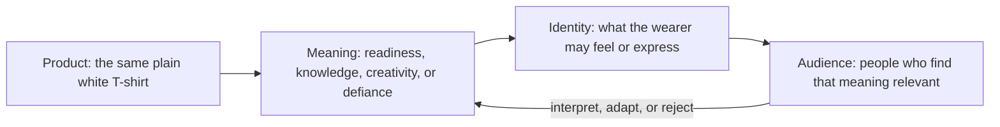

# Brand Archetypes and Meaning

A plain white T-shirt is a practical object: it can be worn, washed, folded, and paired with other clothes. But people do not choose products only for their physical properties. A product can also represent a kind of life, a value, or a version of oneself that someone wants to express.

Branding is one way organizations shape these meanings. **Brand archetypes** are a framework for describing familiar roles and story patterns that help a brand feel recognizable. An archetype gives a team a shared starting point for decisions about a brand's voice, imagery, behavior, and promises. It is not a substitute for knowing the audience or understanding the product.

One useful question guides the work:

> What does the audience get to feel, imagine, or become by choosing this brand?

The answer should connect to something the product or organization can credibly offer. A plain shirt might help someone feel prepared, express a creative point of view, or enjoy a comfortable everyday choice. It cannot, by itself, make someone a different person.

## A Useful Set of Archetypes

The following descriptions are practical prompts, not fixed definitions. Different branding frameworks may name or group archetypes differently, and the meaning of a symbol changes across cultures and communities.

| Archetype | Common story or desire | Possible white T-shirt expression |
| --- | --- | --- |
| Explorer | Freedom, discovery, and independence | A dependable layer for open-ended days and changing plans |
| Sage | Understanding, truth, and informed choices | A clear product page with fabric, fit, care, and price easy to compare |
| Creator | Imagination, originality, and making | A simple canvas styled for customization, layering, or personal projects |
| Ruler | Order, quality, and control | A precise presentation emphasizing consistent sizing and careful construction, if supported by facts |
| Caregiver | Support, care, and contribution | A shirt paired with genuinely useful care or repair guidance |
| Rebel | Challenging conventions and independence | A campaign that questions fashion rules without pretending the shirt itself is revolutionary |
| Hero | Effort, courage, and achievement | A practical garment shown as part of someone's demanding day, without false performance claims |
| Everyperson | Belonging, familiarity, and everyday usefulness | An approachable basic presented for ordinary routines and a range of people |
| Innocent | Simplicity, optimism, and ease | A fresh, uncomplicated look focused on comfort and straightforward information |
| Jester | Play, humor, and shared amusement | A funny campaign that treats the ordinary shirt with lightness |
| Lover | Beauty, closeness, and sensory pleasure | An intimate focus on the feel, drape, or styling of the shirt, described honestly |
| Magician | Transformation, possibility, and wonder | A styling story showing how a basic piece can shift the mood of an outfit, not transform the wearer's life |

These patterns can help a team notice what it is communicating. For instance, a Sage-like presentation might prioritize explanations and comparisons, while a Jester-like one might use humor and surprise. Neither is automatically better. The appropriate choice depends on the product, the audience, and the experience the organization can genuinely deliver.

## The Same Product, Different Archetypes

The examples below imagine the identical plain white T-shirt: same garment, material, fit, and price. Only its presentation changes. The audience is not being promised a new product; each version invites a different interpretation of the same one.

### Explorer: Ready for the Unplanned

The shirt is folded beside a day bag, then worn on a train, at a roadside stop, and during an ordinary walk. The copy emphasizes versatility and readiness for plans that change. The audience is invited to imagine a life with room for discovery.

The ethical limit is important: travel imagery should not imply that a basic cotton shirt offers technical outdoor protection or special performance unless it actually does.

### Sage: Know What You Are Choosing

The shirt appears in clear front, back, and detail views. A size chart, care instructions, fabric information, and price are easy to find. The tone is measured rather than grand. The audience is invited to feel informed and confident in comparing options.

The ethical limit: precise layouts do not prove quality. Any claims about material or construction still need to be accurate and supportable.

### Creator: A Starting Point, Not a Uniform

The shirt is shown customized with a small hand-painted design, layered under different clothes, or used as the starting point for a personal project. The campaign celebrates making and individual expression. The audience is invited to imagine what they could create with an ordinary blank piece.

The ethical limit: show customization as an option, not as something included with the shirt if it is not. Do not imply that buying a basic object automatically makes someone creative.

### Rebel: Refuse the Fashion Script

The shirt is photographed in a deliberately unpolished setting with copy that pokes fun at the idea that every garment needs a grand identity. The audience is invited to question status-driven fashion and enjoy the contradiction of a plain item presented with attitude.

The ethical limit: a rebellious visual style is still marketing. It should not disguise price or product details, or suggest the shirt is ethically superior without evidence.

These positions are dramatically different, although the garment stays the same. Their difference comes from the story, imagery, voice, and invitation to the audience, not from an invented change in the shirt's physical qualities.

## Connecting Product to Audience

An archetype can help translate a product feature into a possible meaning, then into an identity the audience may recognize. The audience's context matters throughout: meaning is not simply inserted into a product by a brand. People interpret, accept, adapt, or reject the invitation.

The arrows are a thinking tool, not a guarantee. A brand may frame the shirt as a symbol of adventure, but an audience member may simply want an affordable shirt that fits. That practical interpretation is valid too.

## Archetypes Are Not Destiny

Archetypes are generalized cultural and narrative models, not literal personality diagnoses. They do not sort people into twelve permanent types, and they cannot predict an individual's behavior. A person may value independence in one situation, care and belonging in another, and humor in a third.

The same is true of brands. An organization may use a Sage-like voice when explaining product details and a Caregiver-like approach in customer support. A single campaign might combine Creator and Everyperson qualities. The goal is not to force every decision into one label; it is to create enough coherence that the experience feels intentional.

Context also matters. A symbol that suggests freedom to one audience may suggest risk or exclusion to another. A tone that feels playful in one culture may seem disrespectful in another. Teams should research the people they hope to reach and test interpretations instead of assuming a universal response.

Finally, a brand's actions matter more than its chosen label. Calling a company a Caregiver does not make it caring. The archetype is useful only when the organization's choices and behavior support the meaning it claims.

## Questions to Ask When Choosing an Archetype

- What does the audience need, value, or hope to express in this situation?
- What might someone feel, imagine, or become by choosing this product?
- Which product qualities support that meaning, and which claims would go beyond the evidence?
- Does this archetype fit the organization's actual behavior, not just its desired image?
- How might different people or cultural communities interpret this story?
- Could another archetype express the idea more honestly or accessibly?
- Where should the audience be free to interpret the product in their own way?

## What You Should Remember

- Archetypes are a practical branding framework for developing recognizable meaning, not fixed categories of people.
- A product's physical qualities and the meanings attached to it are related but not identical.
- The same plain white T-shirt can suggest exploration, informed choice, creativity, or rebellion through different presentations.
- Audiences interpret brand stories through their own experiences and cultural contexts; a brand cannot control what a product means to everyone.
- Choose an archetype that fits the audience and the organization's real behavior, and keep every product claim truthful.