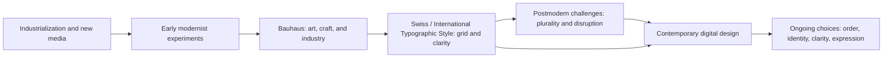

# Design Language: Modernism, Postmodernism, and What Comes Next

Design is not decoration added after an idea is complete. Choices about type, spacing, color, images, and layout affect what people notice and how they understand it. A strict grid can suggest order and reliability. A crowded collage can suggest energy, conflict, or humor. Neither style has one universal meaning, but visual choices carry ideas.

This chapter follows a short path from early modernism through Bauhaus and Swiss / International Typographic Style, then considers postmodernism's challenge to modernist ideals. The point is not to memorize a timeline of styles. It is to notice a continuing tension: designers balance order with disruption, clarity with expression, and shared systems with particular identities.

## A Short Historical Path

In the late nineteenth and early twentieth centuries, industrialization, expanding cities, new technologies, and mass communication changed everyday life. Designers and artists faced new materials, audiences, and ways to reproduce images and information. Many modernists argued that design should respond to contemporary life rather than simply copy historical styles. They explored geometric forms, simplified shapes, new materials, and ways to connect art, craft, and industry.

The Bauhaus, founded in Germany in 1919, became an influential school and workshop for exploring relationships among art, craft, architecture, and industrial production. Its designers and teachers did not all make identical work, but the school is often associated with experimentation, functional thinking, geometric form, and the idea that design could shape modern everyday life. It closed in 1933 under pressure from the Nazi regime; its ideas and people continued to influence design in many places.

After the Second World War, the **Swiss Style**, also called the **International Typographic Style**, developed and spread through graphic design. It is associated with clear information, asymmetrical layouts, sans-serif type, photography, and carefully organized grids. The grid was not merely decoration: it helped designers align elements and create consistent systems across a page or set of materials. The style's name reflects its aspiration to communicate across languages and locations, although no design language is truly neutral or equally clear to everyone.

From the 1960s onward, postmodern designers challenged the idea that restraint, order, and universal rules were always the best answers. Postmodern work often embraced plurality, quotation, irony, disruption, and expressive typography. It could mix historical references, popular culture, and conflicting visual styles rather than hide those differences inside one orderly system. This was not simply a rejection of function: it questioned who defines function, whose culture is treated as universal, and whether clarity must always look restrained.

## Two Approaches in Conversation

Modernist and postmodern approaches are useful contrasts, not rigid boxes. A design can use a grid and still be expressive; it can quote older styles while presenting information clearly. The same designer may choose different approaches for different audiences and tasks.

| Design question | Modernist tendency | Postmodern tendency | A question for today |
| --- | --- | --- | --- |
| Order or disruption? | Organize elements into a coherent system. | Break or expose the system to create energy or invite questioning. | Does the experience need predictability, surprise, or both? |
| Universality or identity? | Seek communication that can work across contexts. | Emphasize that meaning is situated, plural, and shaped by culture. | Who is included in the assumed “everyone”? |
| Clarity or expression? | Prioritize legibility and direct communication. | Use expressive forms that may carry emotion, attitude, or ambiguity. | Can expressive choices coexist with essential clarity? |
| Grid or anti-grid? | Align elements to a consistent structure. | Disrupt alignment or make the structure visibly unstable. | Which parts should stay consistent, and where can variation help? |
| Restraint or abundance? | Reduce visual elements to focus attention. | Layer references, images, and type to create richer associations. | Is the amount of information appropriate for this audience and task? |
| Function or irony? | Make form serve the task and content. | Use humor or contradiction to question expectations, including design conventions. | Does the joke clarify the experience or get in its way? |

## The Tension in Contemporary Digital Design

These debates continue in websites, apps, and digital products. They have not ended with a single winning style.

- **A transit app** may use a strict grid, consistent symbols, and strong hierarchy so a traveler can find the next departure quickly. A service announcement may interrupt that system with a bold color or unusual composition to draw attention to a disruption.
- **An online store** may use restrained product pages to make price, fit, and specifications easy to compare, while a campaign page uses oversized type, layered images, or humor to express a particular identity.
- **A community website** may follow familiar navigation conventions so new visitors can find information, while using colors, language, and imagery specific to the community it serves. Familiarity can aid access, but imported conventions should not erase local needs.
- **A creative portfolio** may deliberately break a grid to express a maker's point of view. It still needs readable text, working navigation, and controls that people can use.

Digital design also has practical demands that a poster does not: responsive screens, keyboard navigation, readable contrast, motion preferences, and changing content. A design can be visually disruptive without making essential information inaccessible. Conversely, a tidy interface is not automatically usable if its labels are unclear or its controls are hard to reach.

## How to Read a Design

When you encounter a design, look at what it does before deciding whether you like it. Try these questions:

1. **What do I notice first?** Identify the headline, image, color, or control that gets the strongest emphasis.
2. **How is information organized?** Look for alignment, spacing, repetition, contrast, and the path your eye follows.
3. **What is the type doing?** Does it prioritize legibility, authority, friendliness, humor, or expression?
4. **What feels included or left out?** Consider whose language, body, culture, and situation the design seems to assume.
5. **What does the design ask me to do or believe?** Separate information and evidence from mood and suggestion.
6. **What happens when the context changes?** Consider another screen size, a different language, a low-vision reader, or someone unfamiliar with the conventions.

These questions turn visual judgment into analysis. A grid may make information easier to compare, but it can also make a page feel impersonal. Expressive type may create a memorable voice, but it may also make instructions difficult to read. The effect depends on the design and the people encountering it.

## The Same White T-Shirt, Two Design Languages

Imagine the same plain white T-shirt, with no change to its material, fit, or price.

A **modernist presentation** could show it in a centered, evenly lit photograph with front and back views, a disciplined grid, a clear type hierarchy, and concise product information. It might feel precise, dependable, and easy to compare. Those impressions come from the presentation; they do not prove the shirt's quality.

A **postmodern presentation** could place the same shirt in a layered collage with clashing type sizes, a playful quotation from fashion advertising, and an intentionally awkward crop. It might feel ironic, individual, or skeptical of polished sales language. The shirt itself has not become rebellious or more expressive; the design invites the audience to read it that way.

Both versions can make price, sizing, and product details clear. Style changes the mood and associations around the garment, not the facts about what the customer receives.

## A Design-History Map

This simplified map shows influence and reaction, not a rigid sequence in which each style replaces the last.

Contemporary designers can draw on both modernist systems and postmodern experimentation. The map is a starting point for asking what a design borrows, changes, or argues against.

## Museum Research

Use museum and institutional collections to find authentic examples rather than relying only on summaries or unattributed images. Collections and catalog records change, so verify the object, designer, date, medium, and institution directly before using an example in your work.

Search collections such as The Metropolitan Museum of Art, MoMA, Cooper Hewitt, the V&A, Bauhaus archives, or another credible museum, university, or design institution. Try focused search terms such as:

- `Bauhaus poster typography`
- `Swiss International Typographic Style poster`
- `modernist graphic design grid`
- `postmodern graphic design typography`
- `Bauhaus textile design`

When you find an object, record its title, creator if listed, date, medium, and collection. Then describe what you can actually observe: its layout, type, color, materials, and imagery. Do not assume an object belongs to a movement only because a search result says so; check the institution's catalog information and compare it with reliable historical context. If you cannot verify an object or detail, leave it out and describe the design idea more generally.

## What You Should Remember

- Modernism developed amid major changes in industry, technology, and communication; Bauhaus and Swiss typography are important parts of that history, not the whole story.
- Modernist grids, hierarchy, clarity, reduction, and function are choices with effects, not neutral laws.
- Postmodernism questioned modernist certainty and restraint through plurality, irony, disruption, quotation, and expressive typography.
- Contemporary digital design continues to balance order and disruption, universality and identity, clarity and expression, grid and anti-grid, restraint and abundance, and function and irony.
- The same white T-shirt can feel like a different product when its presentation changes, even though the object itself stays the same.
- Research real examples in museum and institutional collections, and verify their catalog details before citing them.