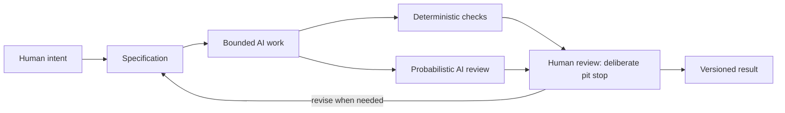

# Directing the Work: Meaning, Design, and AI

Persuasion, brand archetypes, and design language are three connected ways to think about communication. They help a team move from a broad intention to concrete choices without pretending that a style or tool can make every decision for them.

| Lens | Guiding question | Example for the plain white T-shirt |
| --- | --- | --- |
| Persuasion | What response are we trying to enable? | Help shoppers understand whether the shirt suits their needs and decide freely. |
| Archetype | What meaning or identity are we expressing? | Present it as an Everyperson basic for everyday use, or an Explorer's flexible travel layer. |
| Design language | How should that meaning look and feel? | Use clear product details and a measured grid, or documentary travel imagery and practical captions. |

Together, these lenses connect intention, meaning, and form. They are useful for directing people and AI systems because they make creative choices easier to describe, inspect, and revise. They do not guarantee that an audience will interpret a message as intended.

## Using the Three Lenses to Direct AI

An AI assistant can draft copy, suggest layouts, generate alternatives, or help inspect a set of requirements. The result improves when the request explains the purpose and boundaries rather than asking for something vague like “make this persuasive” or “make it modern.”

Before asking for work, decide:

- **Persuasion:** What should the audience be able to understand, consider, or do? What must they remain free to decide?
- **Archetype:** What feeling, meaning, or identity should the work invite? What should it avoid implying?
- **Design language:** What visual and verbal choices support that meaning? Which details need to remain clear or accessible?

For example, a bounded request could ask an assistant to draft a product-page outline for the same white T-shirt, aimed at people comparing everyday basics. It could specify an Everyperson tone, clear fabric and sizing details, an honest return of uncertainty where facts are missing, no invented product claims, and a simple grid-based layout. That request gives the AI direction while leaving the student responsible for checking the result against reality.

These lenses are a control framework, not a magic formula. If the prompt asks for an identity the product cannot credibly support, or a visual style that hides important information, the output may be polished but still wrong.

## Bound the Task with a Specification

A **specification** states what the work is for, what it must include, what it must avoid, and how completion will be checked. It creates a boundary around AI work so the assistant has a clear target and does not expand the assignment unnecessarily.

A useful specification might name:

- the intended audience and purpose
- required content, format, and output location
- constraints such as word count, tone, accessibility, or claims that need evidence
- examples or design direction, when relevant
- acceptance criteria that can be checked after generation

The specification should be detailed enough to guide the work, but it should not pretend every creative judgment can be reduced to a checklist. For the T-shirt example, “show the same shirt through an Explorer archetype” is a direction; “do not imply technical weather protection unless verified” is a boundary; “include a readable price and size guide” is a checkable requirement.

## Check What Can Be Checked

**Deterministic checks** produce the same result when run against the same input and rules. A script can check whether required files exist, headings are present, links resolve, or a document contains exactly one Mermaid block. A test can check whether a program returns an expected value for a defined input.

These checks are useful because they are cheap, repeatable, and consistent. They can catch omissions early and free people to spend more time on questions that require interpretation. They are not proof that the work is good: a chapter can contain every required heading and still be confusing, inaccurate, or unkind.

AI-assisted review can help identify possible gaps, unclear phrasing, contradictions, or edge cases. But AI review is **probabilistic**: it can miss an issue, raise a false alarm, or sound confident while being mistaken. Its output is another suggestion to evaluate, not a certification that the work is correct.

## The Human Pit Stop

Think of an AI workflow as a race car that can keep circulating while automated checks run. A pit stop is a deliberate moment to inspect the tires, fuel, and condition before sending the car back out. Human review serves a similar purpose: it pauses the momentum at selected points to inspect the work that automated checks cannot judge reliably.

People remain responsible for judgment, meaning, truthfulness, context, and final decisions. A human reviewer can ask whether a claim is supported, whether the intended audience is represented respectfully, whether the design communicates the right thing, and whether the result actually serves its purpose. The reviewer can revise the specification, request another draft, or reject the output.

Review is most valuable at meaningful checkpoints: before a draft is accepted, before factual claims are published, and before a change is merged or submitted. The goal is not to inspect every keystroke. It is to stop where a mistake would matter and use human attention deliberately.

## Why Version Control Matters

When AI generates or revises work, it can be difficult to remember what changed and why. **Version control**, such as Git, records changes over time. A student can compare a new draft with the earlier version, see which files changed, preserve a known-good state, and recover from an unwanted edit.

This history makes AI work more traceable. Small, focused changes are easier to review than one large replacement. A commit can record a meaningful checkpoint after the student has inspected the result. Version control does not make a change correct, and it does not replace review; it makes the work easier to understand and recover.

## The Complete Workflow

The workflow below makes room for repeatable automation and deliberate human review. If a check or review finds a problem, revise the bounded work and run the relevant checks again before keeping the versioned result.

The sequence begins with human intent and ends with a result that has been reviewed and recorded. AI can help at several stages, but it does not own the purpose or the final decision.

## Questions for Next Week

- Which part of a task benefits most from a precise specification, and which part needs room to explore?
- What can a deterministic check verify in your own work? What important quality can it not measure?
- When would you stop for a human pit stop instead of trusting an automated pass?
- How might an archetype or design style communicate differently to another audience or cultural context?
- What would you want to see in version history before accepting an AI-generated change?

## What You Should Remember

- Persuasion defines the response a design aims to enable; archetype gives it meaning or identity; design language gives that meaning a visible and felt form.
- These lenses can make AI instructions more specific, but they do not guarantee a good result.
- A specification bounds the work, and deterministic checks catch repeatable, checkable problems.
- AI review can be useful, but it is probabilistic; human judgment remains essential for truth, context, meaning, and final decisions.
- Like a race car's pit stop, human review is a deliberate inspection at important moments while automation continues to do its work.
- Git makes AI-generated changes traceable and recoverable, but only review can decide whether a change should stay.